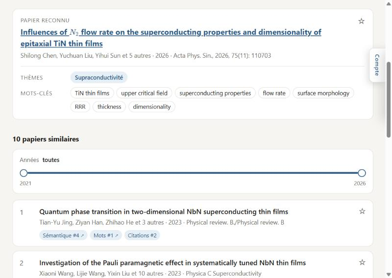
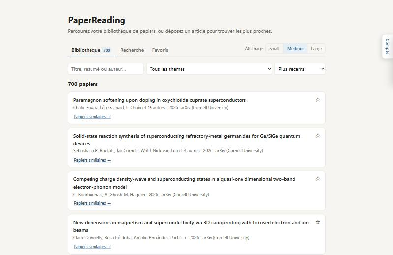
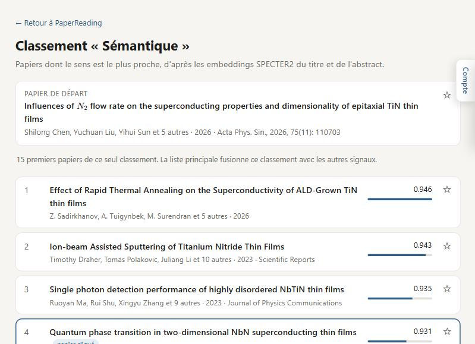
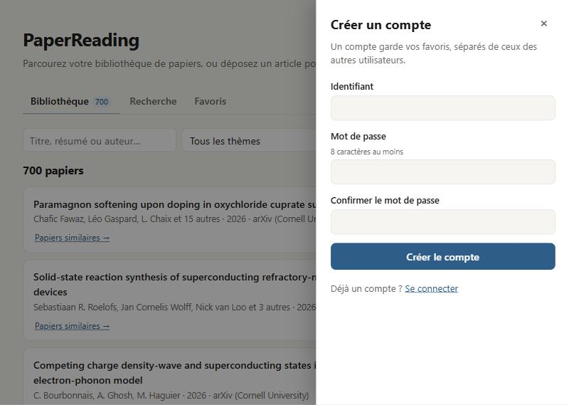
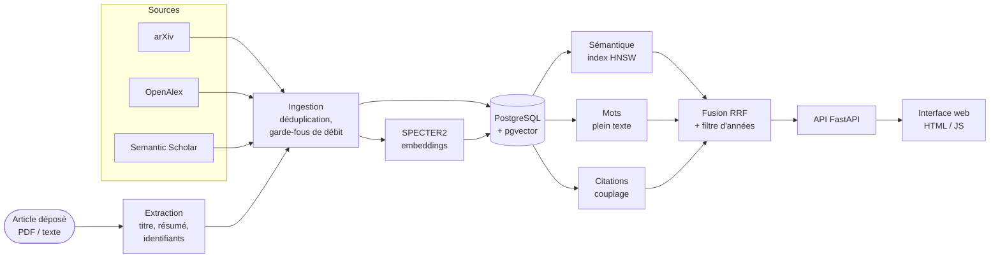

<div align="center">

# PaperReading

**Trouver les articles scientifiques vraiment proches d'un article donné, pas seulement ceux qui partagent ses mots.**

[](https://github.com/ElliotGalaor/PaperReading/actions/workflows/ci.yml)
[](https://github.com/ElliotGalaor/PaperReading/actions/workflows/cd.yml)




</div>

## En bref

On dépose un article (PDF ou texte) : PaperReading le reconnaît, en extrait les **thèmes** et les
**mots-clés**, puis retrouve dans sa bibliothèque les papiers les plus proches. Chaque résultat
explique **pourquoi** il est proposé, en combinant trois signaux indépendants :

| Signal | Ce qu'il mesure | Technique |
|---|---|---|
| **Sémantique** | le sens du titre et du résumé | embeddings **SPECTER2** (modèle conçu pour comparer des articles) + recherche vectorielle **pgvector** |
| **Mots** | le vocabulaire partagé | recherche plein texte PostgreSQL |
| **Citations** | les références bibliographiques communes | couplage bibliographique (graphe OpenAlex) |

Les trois classements sont fusionnés par **Reciprocal Rank Fusion**, une méthode qui combine des
rangs plutôt que des scores d'échelles différentes. Le projet vise la physique, la chimie et les
mathématiques (arXiv), mais rien n'est propre à ces domaines.

## Fonctionnalités

- 📚 **Bibliothèque** paginée côté serveur : recherche titre / résumé / auteur, filtre par thème, tri.
- 📄 **Dépôt d'un article** par glisser-déposer : identification arXiv / DOI vérifiée par le titre, extraction du titre et du résumé sinon.
- 🏷️ **Thèmes et mots-clés** du papier déposé (catégories arXiv en clair, extraction YAKE nettoyée).
- 🔎 **Recherche hybride** avec explication par signal ; chaque étiquette ouvre le **classement complet** de ce signal.
- 📅 **Filtre d'années** par curseur, appliqué *avant* la sélection des candidats (les meilleurs de la période, pas un sous-ensemble du top général).
- ⭐ **Comptes et favoris** propres à chaque utilisateur, connexion dans un panneau coulissant.
- ∑ **Formules LaTeX** mises en forme (KaTeX), liens vers les bibliographies des auteurs, affichage Small / Medium / Large, thème clair et sombre, mobile et clavier.

<table>
  <tr>
    <td></td>
    <td></td>
  </tr>
  <tr>
    <td align="center"><em>Bibliothèque : 700 papiers, recherche, thèmes, tri</em></td>
    <td align="center"><em>Classement « Sémantique » : le papier cliqué est mis en évidence</em></td>
  </tr>
  <tr>
    <td></td>
    <td></td>
  </tr>
  <tr>
    <td align="center"><em>Thème sombre, affichage « Large » avec résumés</em></td>
    <td align="center"><em>Création de compte sans quitter la page</em></td>
  </tr>
</table>

## Architecture



| Couche | Choix |
|---|---|
| Langage | Python 3.11+ (typage moderne, Pydantic) |
| API | FastAPI, Uvicorn |
| Données | PostgreSQL 16, **pgvector** (index HNSW, parcours itératif filtré), psycopg 3 |
| Modèles | SPECTER2 (Hugging Face, adapters), YAKE |
| Front | HTML / CSS / JavaScript sans framework, KaTeX |
| Outillage | pytest, ruff, GitHub Actions, Docker, GitHub Container Registry |

## Qualité et pratiques d'ingénierie

- ✅ **124 tests** : tests unitaires (API, moteur, extraction, sécurité) et **tests d'intégration contre une vraie base PostgreSQL + pgvector** (import, recherche hybride, comptes, API de bout en bout).
- 🔁 **Intégration continue** : lint ruff et tests sur **Python 3.11 à 3.14** à chaque pull request ; job d'intégration avec un service PostgreSQL.
- 🚀 **Déploiement continu** : image Docker construite à chaque PR, publiée sur **ghcr.io** après une CI verte sur `main`, version et release GitHub sur un tag.
- 🔐 **Sécurité** : mots de passe hachés avec **scrypt**, sessions en cookie HttpOnly dont seule l'empreinte est stockée, attente croissante après des échecs de connexion, conteneur sans privilèges.
- 🤝 **Respect des services tiers** : verrou partagé et cache d'une journée pour l'API arXiv (1 requête / 3 s), réessais limités, plafonds de résultats.
- ♿ **Accessibilité** : navigation au clavier (onglets, curseurs, panneaux), attributs ARIA, `prefers-reduced-motion`, contraste en thème clair et sombre.
- 🗂️ **Travail en équipe** : [issues](https://github.com/ElliotGalaor/PaperReading/issues) avec critères d'acceptation, [pull requests](https://github.com/ElliotGalaor/PaperReading/pulls?q=is%3Apr) relues et liées aux issues, modèles d'issue et de PR.

## Démarrage rapide

**Avec Docker** (base + application) :

```bash
git clone https://github.com/ElliotGalaor/PaperReading.git
cd PaperReading
docker compose --profile app up -d --build
docker compose exec app papersim ingest-arxiv "cat:cond-mat.supr-con" --max 200
```

Puis ouvrir <http://127.0.0.1:8000>.

**En local** (développement) :

```bash
docker compose up -d                      # PostgreSQL + pgvector
python -m venv .venv && source .venv/bin/activate
pip install -e ".[embeddings,dev]"
papersim init-db
papersim ingest-arxiv "cat:cond-mat.supr-con" --max 200
papersim serve
```

Tests : `pytest` (unitaires) ; `pytest -m integration` avec une base de test dédiée (voir `tests/integration/conftest.py`).

Le **[guide détaillé](docs/GUIDE.md)** couvre la configuration, l'API, les sources de données, les
comptes et les garde-fous.

## Feuille de route

Les prochaines étapes sont suivies dans les [issues](https://github.com/ElliotGalaor/PaperReading/issues?q=is%3Aissue+is%3Aopen+label%3Abacklog) :
texte intégral depuis la source LaTeX d'arXiv, **extraction structurée problème / méthode / limites
par LLM** pour retrouver des papiers qui rencontrent le même problème dans d'autres domaines,
identifiants d'auteurs exacts, favoris allégés pour les très gros comptes.

## Auteur

Projet réalisé par [ElliotGalaor](https://github.com/ElliotGalaor).
